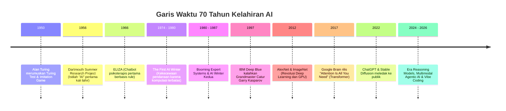
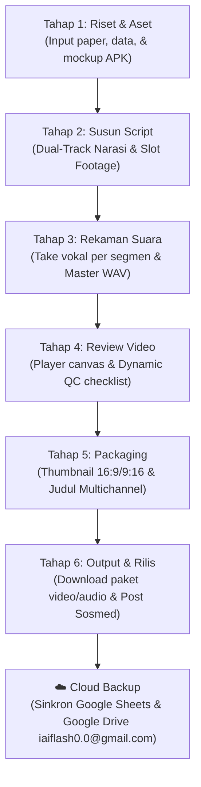

# 🧠 Master Content Strategy & Roadmap: AI Evolution & App Showcase
### *Sistem Operasi Produksi Konten Kreator AI — Dikelola melalui CraftAI Studio*

---

## 📌 1. Executive Summary & Visi Kreator

Dokumen ini adalah cetak biru (*master blueprint*) strategi konten video (YouTube Longform, Shorts, TikTok, dan Instagram Reels) yang akan diproduksi menggunakan aplikasi **CraftAI Studio** (versi Web & APK Mobile).

### 🎯 Visi & Positioning Brand:
> **"Bukan Sekadar Teori, Tapi Bukti Nyata: Membongkar Dunia AI dari Akar Sejarah Hingga Membuktikan Solo Creator Bisa Bikin Belasan Aplikasi Modern Menggunakan AI!"**

Banyak kreator hanya membacakan berita AI tanpa pernah membangun produk nyata. Positioning kita adalah **AI-Native Builder & Educator**:
1. Mengedukasi audiens tentang pemahaman AI yang fundamental dan mendalam (bebas clickbait bodoh).
2. Membedah perkembangan teknologi frontier paling mutakhir secara kritis dan mudah dipahami orang awam.
3. **Puncak Hook / Flexing Portofolio**: Memamerkan deretan **APK fungsional** yang dibuat sendiri menggunakan AI bantuan (*AI-assisted development*), membuktikan kepada audiens bahwa era sekarang memungkinkan siapa saja merealisasikan ide aplikasi tanpa tim ratusan orang.

---

## 🏛️ BAB 1: Asal-Usul & Sejarah Kelahiran AI (The Genesis)

Tujuan pilar ini adalah membangun kredibilitas dan memberikan wawasan bernilai tinggi yang jarang dibahas secara runtut oleh konten kreator lokal.



### 🎬 Ide Konten & Narasi Kunci:
1. **Episode 1.1: "Komputer Pertama yang Bisa Mikir Ternyata Gedenya Serumah"**
   - **Hook**: Kenapa Alan Turing merumuskan tes kecerdasan mesin di tengah dunia yang bahkan belum punya microchip silikon?
   - **Inti Narasi**: Membedah konsep *Imitation Game* (1950). Kecerdasan mesin awalnya didefinisikan bukan dari "apakah ia punya jiwa", melainkan "apakah perilakunya bisa membedakan manusia dari mesin".
   - **Visual Cue**: Footage tabung hampa (vacuum tube), teletype mekanik kuno, dan diagram interaktif dua pintu.

2. **Episode 1.2: "Kisah Dua Kali AI Winter: Waktu Dunia Menganggap AI Itu Khayalan"**
   - **Hook**: Riset AI sempat dianggap penipuan ilmiah dan uang miliaran dollar distop total dua kali. Kenapa?
   - **Inti Narasi**: Masalah *combinatorial explosion* dan keterbatasan memori perangkat keras tahun 70-an vs janji manis ilmuwan yang terlalu dini. Pelajaran penting untuk gelembung hype AI hari ini.

3. **Episode 1.3: "Paper 8 Halaman dari Google yang Mengubah Seluruh Dunia (Transformer 2017)"**
   - **Hook**: Kenapa ChatGPT, Claude, dan Gemini punya kakek buyut yang sama, yaitu paper tahun 2017 berjudul *"Attention Is All You Need"*?
   - **Inti Narasi**: Bagaimana mekanisme *Self-Attention* menyingkirkan model rekursif kuno (RNN/LSTM) dan memungkinkan pemrosesan data paralel raksasa di GPU.

---

## 🔬 BAB 2: Jenis-Jenis AI dan Perkembangannya Masing-Masing

Audiens sering bingung membedakan antara AI, Machine Learning, Deep Learning, dan Generative AI. Di bab ini, kita hadirkan taksonomi yang visual, tegas, dan mudah dicerna.

| Kategori AI | Logika Dasar | Contoh Populer | Titik Lompatan / Evolusi |
| :--- | :--- | :--- | :--- |
| **1. Symbolic / Rule-Based AI** | Aturan kaku `IF-THEN-ELSE` logika formal manusia. | Sistem Pakar Medis MYCIN, Deep Blue (1997). | Berhasil di problem tertutup (catur), gagal total di dunia nyata yang fleksibel. |
| **2. Machine Learning Klasik (ML)** | Mesin belajar pola statistik dari data tabular tanpa dicoding manual. | Deteksi Spam Email, Prediksi Harga Rumah (Linear Regression, Random Forest, XGBoost). | Mampu prediksi angka & klasifikasi, tapi butuh manusia untuk *feature engineering*. |
| **3. Deep Learning (Jaringan Syaraf Tiruan)** | Lapisan neuron buatan bertingkat (multi-layer neural networks). | Computer Vision (CNN), Pengenalan Suara (RNN), AlphaGo (Deep Reinforcement Learning). | Mampu ekstraksi fitur otomatis dari data mentah (gambar, audio, teks bebas). |
| **4. Generative AI (GenAI)** | Probabilitas distribusi probabilitas untuk **membuat** data baru yang orisinal. | LLM (GPT-4, Claude, Llama), Difusi Gambar (Midjourney, Flux), Video (Sora, Kling, Runway). | Transisi dari "mesin analisis" menjadi "mesin kreasi konten & penalaran bahasa". |
| **5. Agentic AI & Autonomous Systems** | Model diberi tujuan (*goal*), lalu merencanakan langkah, memanggil tool/API, dan mengevaluasi diri sendiri. | Devin, AutoGPT, Claude Computer-Use, Antigravity IDE Agent. | AI bukan cuma menjawab pertanyaan teks, tapi **mengambil tindakan nyata** di komputer/browser. |
| **6. Physical & Embodied AI** | AI terintegrasi dengan sensor fisik dan aktuator dunia nyata. | Robot Humanoid (Figure 02, Tesla Optimus), Tesla FSD, Boston Dynamics Atlas. | Integrasi model visi-bahasa-aksi (*Vision-Language-Action Models / VLA*). |

---

## ⚡ BAB 3: Update AI Paling Mutakhir & SOTA Terkini (State of the Art)

Pilar ini memastikan konten selalu hangat, viral, dan mengantisipasi masa depan industri.

### 1. Pergeseran Paradigma: Dari "Pre-Training Scale" ke "Inference-Time Reasoning"
- Dulu: Menghabiskan jutaan dollar menambah miliaran data token di awal.
- Sekarang: Model diajari berpikir sebelum menjawab (*Test-Time Compute / Chain of Thought*), seperti **OpenAI o1/o3, DeepSeek-R1, dan Gemini 2.0 Flash Thinking**.
- Dampak: Akurasi coding dan matematika melonjak drastis, halusinasi ditekan secara signifikan.

### 2. Gelombang Model Open-Weights yang Mengguncang Silicon Valley
- Fenomena **DeepSeek, Meta Llama 3, Qwen 2.5, dan Mistral**: Model gratis yang bisa dijalankan lokal atau di-hosting murah, dengan performa mendekati model tertutup berbiaya triliunan rupiah.
- Mengapa ini penting buat audiens: Siapa saja sekarang bisa punya "otak buatan" di laptop mereka sendiri secara privat tanpa langganan mahal!

### 3. Revolusi "Vibe Coding" & Solo Software Creator
- Istilah resmi yang dipopulerkan Andrej Karpathy (eks-Director of AI Tesla & Co-founder OpenAI).
- Menjelaskan bagaimana pemrograman berubah: Dari menghafal sintaks dan algoritma rumit, menjadi memberikan arahan arsitektur tingkat tinggi kepada AI agent, sementara AI yang mengetik kode dan debugging secara real-time.

---

## 🚀 BAB 4: Showcase & Pamer Portofolio APK Bikin Sendiri Pake AI
*(Berdasarkan Katalog Aset Nyata di `C:\Users\Asep\OneDrive\Gambar\App Craft\App Idea`)*

Ini adalah **senjata pamungkas** kita untuk membedakan diri dari kreator lain: **Pembuktian portofolio aplikasi mobile!** Kita tunjukkan bahwa dengan memahami AI, kita bisa menghasilkan solusi software nyata.

```
Katalog Ide & Mockup Nyata di Folder App Idea:
├── AppIdea AI Calorie Tracker.jpg
├── AppIdea ShouldIBuyIt Home.jpg
├── AppIdea Video Editing App.jpg
├── AppIdea Medication and Wellness.jpg
├── AppIdea Pet Adoption App.jpg
├── AppIdea Minimal Todo.jpg
├── AppIdea One Photo Day App.jpg
├── AppIdea Reading Publication 01.jpg
├── AppIdea Bus Ticket Booking.jpg
├── AppIdea Modern Event App.jpg / Custom Events.jpg
└── AppIdea Art Gallery Store.jpg / Art Story App.jpg
```

### 📱 Rincian 11 Konsep APK & Sudut Pandang Konten Showcase:

#### 1. 🥗 AI Calorie & Macro Tracker (`AppIdea AI Calorie Tracker.jpg`)
- **Masalah Pengguna**: Malas mencatat gram makanan manual di aplikasi diet konvensional.
- **Solusi AI**: Foto piring makanan -> Model Visi AI mengenali jenis lauk, menakar porsi kalori, protein, lemak, dan karbohidrat secara instan.
- **Sudut Konten Flex**: *"Gua bikin aplikasi penghitung kalori otomatis pakai kamera HP cuma dalam 2 hari dibantu AI vision model!"*

#### 2. 💸 ShouldIBuyIt — The Rational Shopping Guardian (`AppIdea ShouldIBuyIt Home.jpg`)
- **Masalah Pengguna**: Kebiasaan impulsive buying saat melihat diskon marketplace.
- **Solusi AI**: Masukkan link/foto barang -> AI menganalisis jam kerja yang harus ditukar untuk membeli barang itu, tingkat depresiasi, dan memberi skor rasionalitas: *"Beli Sekarang atau Tunda 30 Hari?"*
- **Sudut Konten Flex**: *"Aplikasi AI anti boncos: Aplikasi yang marahin lu kalau mau beli barang ga penting!"*

#### 3. 🎬 Smart Mobile Video Editor (`AppIdea Video Editing App.jpg`)
- **Masalah Pengguna**: Editing video TikTok/Reels di HP memakan waktu lama untuk potong bagian hening (*dead air*) dan ngetik subtitle.
- **Solusi AI**: Auto-transcribe subtitle kinetik bilingual, auto-silence removal, dan smart B-roll matcher.
- **Sudut Konten Flex**: *"Capek edit video manual? Gua coding APK editor video sendiri yang otomatis potong bagian hening pake AI!"*

#### 4. 💊 Medication & Wellness Assistant (`AppIdea Medication and Wellness.jpg`)
- **Masalah Pengguna**: Pasien/keluarga lansia sering salah jadwal minum obat dan tidak tahu jika ada interaksi obat yang berbahaya jika diminum bersamaan.
- **Solusi AI**: OCR resep dokter + database LLM medis untuk mengingatkan jadwal dan memberi peringatan interaksi obat secara ramah.
- **Sudut Konten Flex**: *"Aplikasi asisten kesehatan keluarga yang paham resep dokter tulisan cakar ayam!"*

#### 5. 🐶 Pet Adoption Matchmaker (`AppIdea Pet Adoption App.jpg`)
- **Masalah Pengguna**: Banyak orang mengadopsi hewan tapi akhirnya terlantar karena karakter hewan tidak cocok dengan gaya hidup pemilik.
- **Solusi AI**: Kuis kepribadian berbasis AI yang mencocokkan luas tempat tinggal, waktu luang, dan tingkat alergi adopter dengan profil anjing/kucing yang siap diadopsi.
- **Sudut Konten Flex**: *"Tinder versi adopsi hewan peliharaan: Algoritma pencocok anabul dan adopter idaman."*

#### 6. 📝 Minimal AI Todo & Task Decomposer (`AppIdea Minimal Todo.jpg`)
- **Masalah Pengguna**: Daftar to-do list sering diabaikan karena tugasnya terlalu besar dan bikin kewalahan (*overwhelmed*).
- **Solusi AI**: Ketik tugas besar (misal: "Bikin video YouTube"), AI otomatis memecah menjadi 5 sub-tugas kecil yang berdurasi 15 menit per langkah.
- **Sudut Konten Flex**: *"Aplikasi to-do list yang gak cuma nyatet, tapi mikirin cara nyelesaiin tugas lu satu per satu."*

#### 7. 📸 One Photo Day & AI Memory Recap (`AppIdea One Photo Day App.jpg`)
- **Masalah Pengguna**: Ratusan foto di galeri HP tenggelam begitu saja tanpa pernah dikenang kembali.
- **Solusi AI**: 1 foto per hari dengan catatan emosi singkat. Di akhir bulan, AI membuat narasi visual puitis dan video rekap kilas balik kehidupan.
- **Sudut Konten Flex**: *"Aplikasi visual journaling yang merangkum sebulan hidup lu jadi cerita dokumenter personal."*

#### 8. 📖 Reading Publication & AI Voice Synthesizer (`AppIdea Reading Publication 01.jpg`)
- **Masalah Pengguna**: Banyak artikel dan newsletter bagus tapi tidak sempat membaca teks panjang.
- **Solusi AI**: Ekstraksi poin penting artikel + konversi ke narasi suara podcast alami dengan gaya pembawaan hangat.
- **Sudut Konten Flex**: *"Ubah artikel panjang jadi podcast mini pribadi saat naik motor atau commuting."*

#### 9. 🚌 Bus Ticket Booking & Smart Route Assistant (`AppIdea Bus Ticket Booking.jpg`)
- **Masalah Pengguna**: Memilih rute dan armada bus antarkota sering membingungkan dengan jadwal transit yang tidak pasti.
- **Solusi AI**: AI Trip Assistant yang merekomendasikan jam keberangkatan terbaik menghindari macet tol serta estimasi waktu tiba akurat.
- **Sudut Konten Flex**: *"Redesain total sistem pemesanan tiket bus lokal dengan antarmuka modern dan asisten rute pintar."*

#### 10. 🎨 Art Gallery Store & Art Story App (`AppIdea Art Gallery Store.jpg` & `AppIdea Art Story App.jpg`)
- **Masalah Pengguna**: Menikmati karya seni sering terasa eksklusif dan sulit dipahami tanpa kurator pemandu.
- **Solusi AI**: Scan karya seni -> dengarkan kisah emosional di balik sapuan kuas seniman dengan panduan audio dinamis.
- **Sudut Konten Flex**: *"Museum pribadi di genggaman: Bikin galeri seni digital yang bisa bercerita langsung ke telingamu."*

#### 11. 🎟️ Modern Event & Custom Events Planner (`AppIdea Modern Event App.jpg`)
- **Masalah Pengguna**: Manajemen acara komunitas yang ribet dari pendaftaran, reminder, hingga interaksi peserta.
- **Solusi AI**: Smart ticketing, matchmaking peserta dengan minat serupa di dalam event, dan automated event recap.
- **Sudut Konten Flex**: *"Platform event yang otomatis mempertemukan orang-orang dengan visi yang sama di acara networking."*

---

## 🛠️ BAB 5: Alur Produksi di CraftAI Studio (Dari Ide ke Post)

Semua konten di atas diproduksi menggunakan alur 6 tahap yang sudah tertanam di aplikasi `CraftAI Studio`:



### 🗓️ Jadwal Rencana Rilis Seri Konten (Batch 1: 12 Video):

| No | Format | Topik / Judul Konten | Pilar | Kaitan Showcase APK |
| :-: | :---: | :--- | :---: | :--- |
| **01** | Longform (12m) | Dari Turing Test ke ChatGPT: 70 Tahun Perjalanan Kelahiran AI | Asal-usul | Intro ekosistem tools yang dibangun |
| **02** | Shorts/TikTok | Komputer Pertama Ternyata Gedenya Serumah dan Pakai Tabung Panas! | Asal-usul | B-roll arsip sejarah |
| **03** | Longform (15m) | Jangan Salah Sebut! Bedah Tuntas: Symbolic AI vs ML vs Deep Learning vs GenAI | Jenis AI | Diagram interaktif di CraftAI Studio |
| **04** | Shorts/TikTok | Kenapa Riset AI Sempat Mati Suri 2 Kali? (Kisah Nyata AI Winter) | Asal-usul | Animasi kedinginan AI Winter |
| **05** | Longform (18m) | Era Baru AI 2026: Reasoning Models & Kenapa Pre-Training Mulai Ketinggalan Zaman | Update Baru | Bedah DeepSeek-R1 & OpenAI o1/o3 |
| **06** | Shorts/TikTok | Model AI Gratisan Ini Bikin Panik Perusahaan Triliunan Dollar! | Update Baru | Benchmark token & efisiensi |
| **07** | **Longform (20m)** | **"Gua Bikin 10+ Aplikasi Mobile Sendirian Pake AI (Tanpa Tim Developer)!"** | **Showcase** | **Bedah 11 APK dari folder App Idea** |
| **08** | Shorts/TikTok | Bikin Aplikasi Penghitung Kalori Makanan Otomatis Cuma Pake Kamera HP! | Showcase | Demo `AI Calorie Tracker` |
| **09** | Shorts/TikTok | Aplikasi yang Bakal Marahin Lu Kalo Mau Belanja Impulsif! | Showcase | Demo `ShouldIBuyIt` |
| **10** | Shorts/TikTok | Capek Edit Video Manual? Gua Bikin APK Auto Cut Sendiri Pake AI! | Showcase | Demo `Video Editing App` |
| **11** | Shorts/TikTok | Aplikasi To-Do List yang Mikirin Cara Ngerjain Tugas Lu | Showcase | Demo `Minimal Todo` |
| **12** | Longform (25m) | Panduan Lengkap "Vibe Coding": Cara Bikin Software Impianmu dari Nol Pake AI | Edukasi & Demo | Live build & tutorial step-by-step |

---

## 🎯 Rekomendasi Langkah Selanjutnya di CraftAI Studio:
1. Data proyek di atas sudah siap dimasukkan ke dalam antarmuka `CraftAI Studio`.
2. Buka `index.html` dan pilih proyek konten yang ingin dikerjakan.
3. Jalankan tombol **Cloud Sync** untuk menyinkronkan seluruh database konten ke **Google Sheets** dan semua aset gambar/video ke **Google Drive** akun `iaiflash0.0@gmail.com`.
4. Jalankan script `push_to_github.bat` untuk mem-push seluruh codebase dan rencana kerja ini ke repositori GitHub `iaiflash/Content-Planner`.
