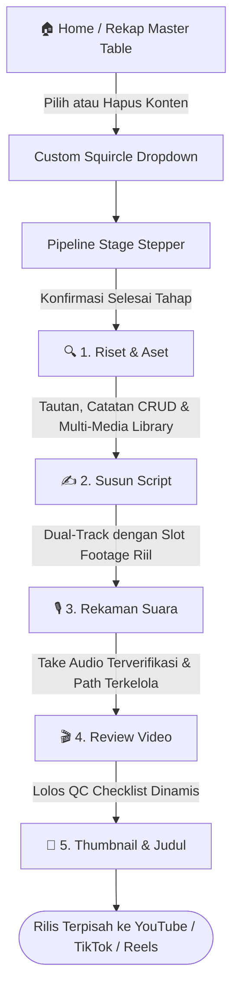

# Technical Requirement Document (TRD) & App Flow
## Proyek: CraftAI Studio — Content OS & Production Pipeline

| Metadata | Detail |
| :--- | :--- |
| **Status** | Updated & Fully Implemented (V3 - Hybrid APK & Laptop Ready) |
| **Arsitektur Menu** | Home Master Table + 5 Dedicated Pipeline Stage Panes |
| **Tech Stack** | Local-First SPA (Single File HTML5/CSS3/Vanilla JS) with LocalStorage Sync |
| **Dialog System** | Custom Toast Notifications & Custom Squircle Modals (Zero Native Dialogs) |
| **Aplikasi Target** | `index.html` |
| **Tanggal Pembaruan** | 29 September 2026 |

---

## 1. Flow Diagram Alur Produksi Terpadu



---

## 2. Struktur Schema Data (TypeScript Interface)

```typescript
export type ContentPillar = 'Fondasi & Sejarah' | 'Taksonomi & Konsep' | 'Update & Praktik';
export type MediaType = 'video' | 'foto' | 'meme' | 'gif' | 'diagram';
export type MediaFormat = '16:9' | '9:16' | '1:1';
export type Platform = 'youtube' | 'tiktok' | 'reels';

export interface ResearchLink {
  id: string;
  title: string;
  url: string;
  type: string;
}

export interface ResearchNote {
  id: string;
  title: string;
  content: string;
}

export interface MediaAsset {
  id: string;
  name: string;
  type: MediaType;
  format: MediaFormat;
  desc: string;
}

export interface LongformSegment {
  id: string;
  seg: string;
  narr: string;
  attachedAssetId?: string | null; // Terhubung langsung ke asset Menu 1
  cue: string;
}

export interface ShortsScript {
  id: string;
  platform: string;
  title: string;
  text: string;
}

export interface AudioTake {
  id: string;
  part: string;
  file: string;
  duration: string;
  quality: string;
  status: 'approved' | 'retake';
}

export interface QcCheckItem {
  id: string;
  text: string;
  checked: boolean;
}

export interface PlatformPackaging {
  main: string;
  options: string[];
  caption: string;
}

export interface VideoProject {
  id: number;
  title: string;
  pillar: ContentPillar;
  stage: 'Riset' | 'Scripting' | 'Recording' | 'Editing' | 'Ready to Upload';
  progress: number;
  targetDuration: string;
  
  // Menu 1: Riset & Aset
  research: {
    links: ResearchLink[];
    notes: ResearchNote[];
    assets: MediaAsset[];
  };

  // Menu 2: Script Studio
  scripts: {
    longform: LongformSegment[];
    shorts: ShortsScript[];
    socialCaptions: Record<Platform, string>;
  };

  // Menu 3: Rekaman Suara
  audioTakes: AudioTake[];

  // Menu 4: Review Video (Player Riil & Drag-Drop Upload)
  review: {
    finalVideoFile: string;
    resolution: string; // Auto-detected (e.g., 1080p (16:9 Landscape) 1920x1080)
    fileSize: string;   // Auto-detected (e.g., 45.2 MB)
    duration?: string;  // Auto-detected mm:ss
    qcList: QcCheckItem[];
    uploadStatus: Record<Platform, string>;
  };

  // Menu 5: Packaging
  packaging: {
    thumbnailFile: string;
    thumbnailConcept: string;
    titles: Record<Platform, PlatformPackaging>;
  };
}

export interface AppState {
  activeTab: 'home' | 'riset' | 'script' | 'rekaman' | 'review' | 'packaging';
  activeProjectId: number;
  currentMediaFilter: 'all' | MediaType;
  activeScriptSubtab: 'longform' | 'shorts' | 'caption';
  activeSosmedTitleTab: Platform;
  projects: Record<number, VideoProject>;
}
```

---

## 4. Arsitektur Dual-View Responsif (Desktop Tables vs Mobile Cards)

Untuk memastikan pengalaman optimal saat dipakai di Laptop (layar lebar) maupun HP/APK (layar sempit) tanpa perlu geser horizontal (zero horizontal scrolling) dan tanpa ada elemen kepotong:

1. **Dual Render Rendering Pipeline:**
   - Desktop (`> 840px`): Menampilkan tabel master data lengkap 4–9 kolom (`.desktop-only-view`) dengan kontrol padat.
   - Mobile (`≤ 840px`): Menampilkan kartu squircle bento (`.mobile-only-view` / `.mobile-data-card`) yang memadatkan informasi, progress bar, badge pilar/format, dan tombol sentuh jempol.
2. **Eliminasi Geser Kanan-Kiri:**
   - Semua tabel data (Home Rekap, Riset Temuan, Media Library, Script Shorts, Audio Vault, QC Checklist) otomatis berganti ke tampilan kartu vertikal saat dibuka di HP.
   - Grid 2-kolom (`.review-split-grid`, `.packaging-split-grid`, `.dual-track-row`) otomatis stack menjadi 1-kolom penuh.
   - Filter media (`.media-filter-row`) otomatis wrap 2 baris (3 tombol per baris) sehingga semua tombol langsung terlihat dan dapat diklik tanpa digeser.
   - Stepper tahapan menggunakan label ringkas (`1. Riset`, `2. Script`, `3. Audio`, `4. Edit`, `5. Siap`) dan subtab script menggunakan label pendek (`Naskah 16:9`, `Shorts 9:16`, `Caption`) sehingga 100% muat di layar HP.
3. **Viewport & Scroll Control:**
   - `html, body, .app-window, .app-body, .card` dikunci dengan `max-width: 100vw; overflow-x: hidden !important; box-sizing: border-box;`.
   - Modals dan Toasts disesuaikan dengan padding responsif, max-height 90vh, dan scroll internal vertikal agar tidak pernah terpotong di HP.

